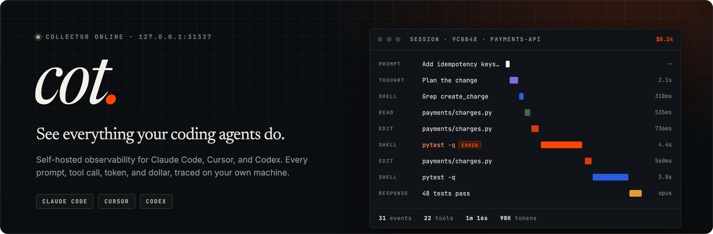
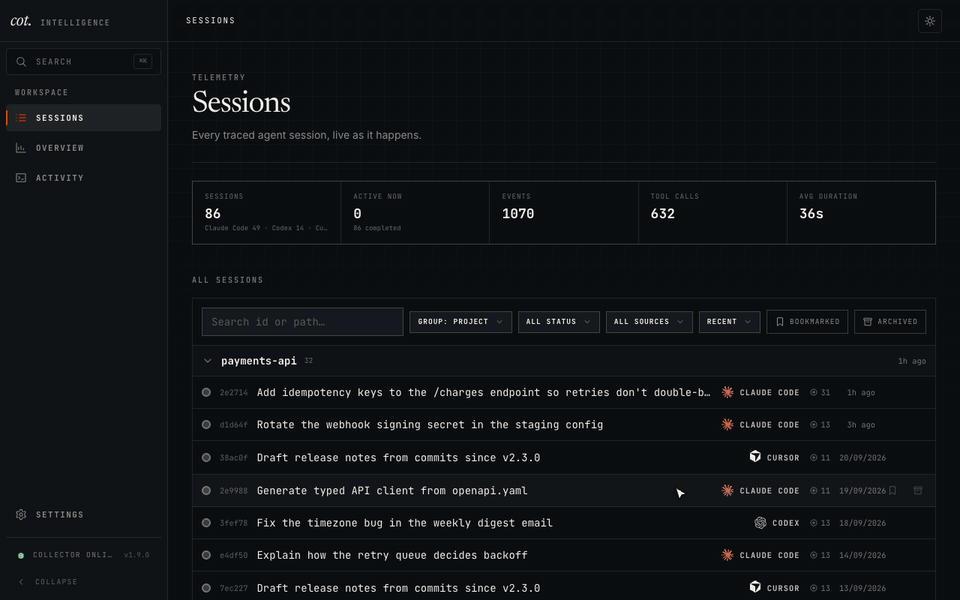
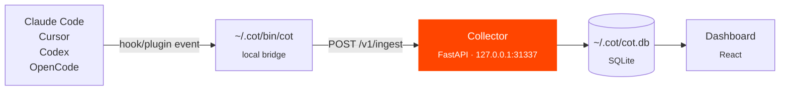

<div align="center">



<br>

**Trace agent reasoning, evaluate outcomes, and ship reliable AI on your own infrastructure.**<br>
No cloud. No accounts. Your traces stay on your machine.

<br>

[](https://github.com/cot-intelligence/cot/releases)
[](https://github.com/cot-intelligence/cot/actions/workflows/ci.yml)
[](LICENSE)
[](https://github.com/cot-intelligence/cot/pkgs/container/cot)

[**Website**](https://cot.run) · [**Quickstart**](#quickstart) · [**Features**](https://cot.run/docs/features) · [**How it works?**](https://cot.run/docs/why-cot) · [**Development**](#development)

</div>

<br>

<div align="center">
  
  <sub>Sessions → timeline → insights → overview → <kbd>⌘</kbd><kbd>K</kbd> search. Demo data; nothing here left anyone's laptop.</sub>
</div>

<br>

## Quickstart

```bash
curl -fsSL https://cot.run/install | sh
```

One command:

1. starts the collector in Docker, bound to localhost
2. installs the local bridge
3. wires up the agents you pick: **Claude Code**, **Cursor**, **Codex**, or **OpenCode**

Cot runs in the background and collects traces while you build. Open the dashboard at **[http://127.0.0.1:31337](http://127.0.0.1:31337)**.

> [!TIP]
> Already running the collector? Install just the bridge and hooks with
> `curl -fsSL http://127.0.0.1:31337/install.sh | sh`.

The default port is **31337**. If it is busy, the installer picks the next free port and saves the URL in `~/.cot/config.json`.

OpenCode 1.18.29+ and OpenCode 2 use one local plugin file. The bridge installer
places it at `~/.config/opencode/plugins/cot.js`. To add it manually after
installing the cot bridge, download
`http://127.0.0.1:31337/opencode-plugin.js` (using your chosen port), save it
at that path, and restart
OpenCode. OpenCode sessions recorded before plugin installation are not imported.

| Command | What it does |
| --- | --- |
| `cot up` | Start or resume the collector |
| `cot down` | Stop the collector, keeping your hooks and local data |
| `cot purge` | Remove the collector, unwire cot hooks, and delete `~/.cot` after asking |

### Ask cot from your agent

`cot mcp` is a read-only MCP server over stdio. Register it, and your agent can list and
search past sessions, read one, and explain what a session cost:

```bash
claude mcp add cot -- ~/.cot/bin/cot mcp
```

Codex takes the same command (`codex mcp add cot -- ~/.cot/bin/cot mcp`). For Cursor, add
`"cot": {"command": "/Users/<you>/.cot/bin/cot", "args": ["mcp"]}` under `mcpServers` in
`~/.cursor/mcp.json`, with the full path. Every tool reads the local collector; nothing
leaves the machine.

### Spend in your status line

`cot statusline` prints one line, `cot · session $0.53 · today $34.18`. Claude Code pipes
its status JSON on stdin, so the session is picked up on its own. Add this to
`~/.claude/settings.json`:

```json
"statusLine": { "type": "command", "command": "~/.cot/bin/cot statusline" }
```

### Usage of one CI run

`cot capture` wraps a headless `claude -p` or `codex exec` run. It saves tokens, cost
and turns to `cot-capture.json` (or `--out FILE`), and on GitHub Actions it also adds a
line to the job summary. No collector is needed:

```bash
cot capture -- claude -p "review this diff"
```

### Sessions from other machines

Copy or mount another machine's home folder, then register it. Its sessions are imported
with the scheduled import, labelled with the machine name:

```bash
cot sources add /Volumes/devbox-home --machine devbox
```

### Semantic search (opt-in)

Point the collector at any OpenAI-compatible embeddings endpoint and ⌘K matches
meaning as well as words. Secrets are masked before any text is sent, and a local model
keeps everything on the machine:

```bash
export COT_EMBEDDINGS_URL=http://127.0.0.1:11434/v1   # Ollama, LM Studio, vLLM, OpenAI
export COT_EMBEDDINGS_MODEL=nomic-embed-text
# optional: COT_EMBEDDINGS_KEY, COT_EMBEDDINGS_DIM (default 256)
```

### Other agents over OpenTelemetry

Agents without a cot hook can export OpenTelemetry instead. Point their OTLP/HTTP exporter
at the collector (JSON or protobuf):

```bash
export OTEL_EXPORTER_OTLP_ENDPOINT=http://127.0.0.1:31337
export OTEL_EXPORTER_OTLP_PROTOCOL=http/protobuf
```

Prompts, tool calls and model usage become events in a session named after the agent's
`service.name`, from GenAI spans (`gen_ai.*`) or agent log events such as Gemini CLI's.
Most agents redact prompt and tool content unless told to export it. Keep hooks for agents
cot already supports: exporting OTel from them too counts their events twice.

## How it works



Agent hooks call the bridge, the bridge posts each event to the collector, and the collector normalizes its category, phase, and token counts into SQLite. If the collector is down, events queue in `~/.cot/spool.jsonl` and replay on the next contact.

## Repository

The collector API, dashboard, bridge scripts, and Docker image live in this repository.

```text
backend/app/   FastAPI collector
bridge/        Installer and cot bridge CLI
src/           React and TypeScript dashboard
```

### Performance

Every collector response carries an `X-Response-Time` header (and `Server-Timing`
for the browser's DevTools), and reads or writes that hold the database longer
than `COT_SLOW_QUERY_MS` (default 100; 0 turns it off) are logged with the code
that ran them. To time the hot endpoints against a running collector:

```bash
scripts/bench_api.sh http://127.0.0.1:31337
```

The Mac app keeps its database in WAL mode, so the dashboard's reads never wait
on hook writes. The Docker image defaults to SQLite's rollback journal, because
WAL is not safe across Docker Desktop's file sharing. On a Linux host, where
`~/.cot` is a local filesystem, set `COT_DB_JOURNAL_MODE=wal` on the container
for the same behavior.

### Development

```bash
docker compose up
```

Open [http://127.0.0.1:31337](http://127.0.0.1:31337), the same port used by the installer.

<details>
<summary><b>Frontend hot reload on the host</b></summary>

<br>

```bash
docker compose run --rm -d --name cot-api -p 127.0.0.1:31337:31337 api
npm install
COT_API_TARGET=http://127.0.0.1:31337 npm run dev
```

Vite serves on [http://localhost:4000](http://localhost:4000) and proxies API calls to the collector on port **31337**. Stop the API container with `docker rm -f cot-api` when done.

</details>

## Links

- **Website:** [cot.run](https://cot.run)
- **GitHub:** [github.com/cot-intelligence/cot](https://github.com/cot-intelligence/cot)
- **Container:** `ghcr.io/cot-intelligence/cot:latest`

## License

Cot is licensed under [AGPL-3.0](LICENSE).

<br>

<div align="center">
  <sub>Built for engineers who want to know what their agents actually did.</sub>
</div>
